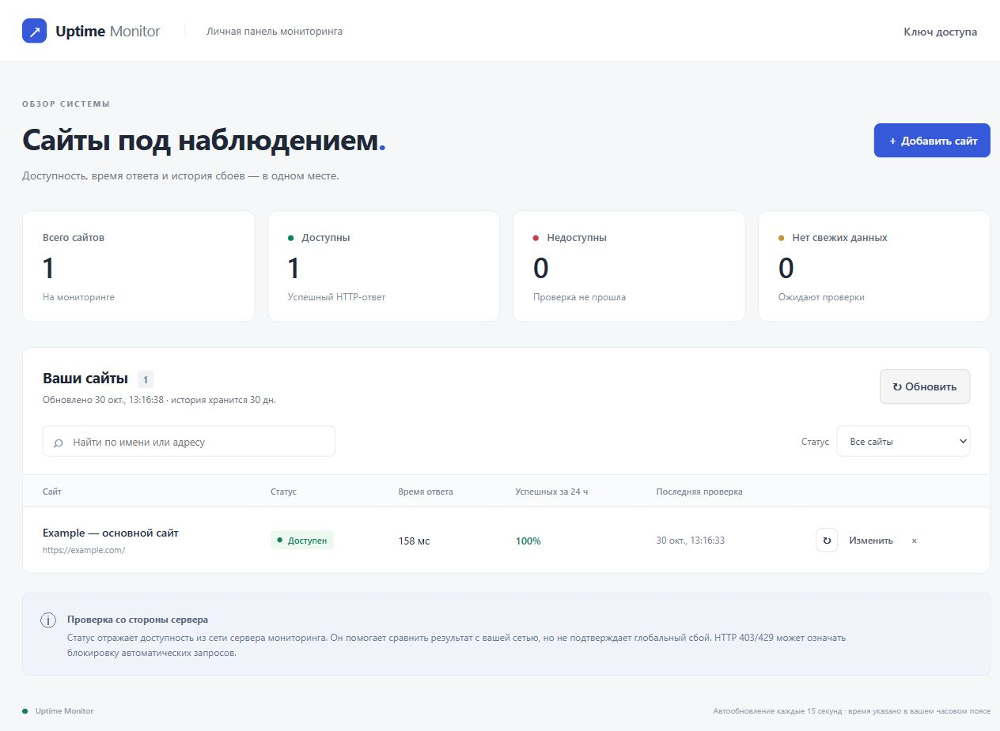

# Uptime Monitor

Самостоятельно размещаемый мониторинг сайтов на **ASP.NET Core 10 + MySQL**. Проверяет HTTP-доступность, сохраняет время ответа и историю, открывает инцидент при сбое и закрывает после восстановления. Веб-панель на русском языке входит в приложение и не требует Node.js или отдельного frontend-сервера.



> Это наблюдение **из сети вашего сервера**, а не глобальная карта сбоев. Чтобы сравнить результат со своей сетью, разместите приложение на отдельном сервере/VPS. Успешная проверка YouTube означает, что указанный URL отвечает; она не гарантирует воспроизведение видео. HTTP 403/429 может означать защиту сайта от ботов.

## Возможности

- Добавление, поиск, изменение и удаление мониторов.
- Автоматические проверки с интервалом 10–86 400 секунд и ручной запуск.
- HTTP-код, задержка до заголовков ответа, история проверок и инцидентов.
- Статусы: доступен, недоступен, ещё не проверен, данные устарели.
- Доля успешных проверок за последние 24 часа и среднее время успешного ответа.
- Веб-панель с поиском, фильтрами и автообновлением каждые 15 секунд.
- Защита API ключом, ограничение запросов, запрет обращений к внутренним адресам.
- MySQL migrations, Docker Compose, тесты и GitHub Actions.

## Быстрый запуск с Docker

Нужен Docker с Compose v2. Из корня репозитория:

```sh
cp .env.example .env
```

В PowerShell: `Copy-Item .env.example .env`.

Замените **все три** примера паролей/ключей в `.env` независимыми случайными значениями. Например, `openssl rand -hex 32` или PowerShell 7: `[Convert]::ToHexString([System.Security.Cryptography.RandomNumberGenerator]::GetBytes(32))`. Для `API_KEY` нужно 32–512 символов. Для паролей в Compose используйте hex/base64url без `;`, `$`, `#` и кавычек.

```sh
docker compose up -d --build
docker compose logs -f api
```

Откройте **http://localhost:8080** и введите `API_KEY` из `.env`. База создаётся, миграции применяются автоматически. MySQL не публикуется на хост, веб-порт по умолчанию доступен только локально. Данные находятся в volume `mysql_data`.

```sh
docker compose down
```

Команда выше сохраняет данные. `docker compose down -v` **удаляет базу**. Изменение паролей в `.env` не меняет уже созданные учётные записи MySQL: для существующего volume пароль меняют в самой базе.

## Локальный запуск без Docker

Нужны .NET SDK 10 и MySQL 8.0/8.4. EF Core и Pomelo остаются на совместимой ветке 9.x; целевая платформа приложения — .NET 10.

1. Создайте отдельную БД `uptime_monitor` и пользователя с правами на неё. Для применения миграций нужны права DDL; для обычной работы — чтение, запись и удаление данных.
2. Сохраните строку подключения в user-secrets (замените пароль):

```sh
dotnet user-secrets set "ConnectionStrings:DefaultConnection" "Server=localhost;Port=3306;Database=uptime_monitor;User=uptime;Password=YOUR_PASSWORD" --project UptimeMonitor.Api
dotnet restore UptimeMonitor.Api.slnx
dotnet tool restore
dotnet ef database update --project UptimeMonitor.Api
dotnet run --project UptimeMonitor.Api --launch-profile http
```

Откройте **http://localhost:5134**. В Development без настроенного ключа API доступен только с loopback-адреса. Если ключ уже задан, введите его в панели. Для проверки режима с ключом:

```sh
dotnet user-secrets set "Security:ApiKey" "YOUR_RANDOM_KEY_AT_LEAST_32_CHARACTERS" --project UptimeMonitor.Api
```

Перезапустите приложение после изменения конфигурации. Для соединения с удалённой MySQL используйте проверку сертификата: `SslMode=VerifyFull;SslCa=/path/to/ca.pem`.

## Настройки

Секреты хранятся в user-secrets или переменных окружения, **не в Git**. В переменных окружения вместо `:` используется `__`.

| Настройка | По умолчанию | Назначение |
| --- | --- | --- |
| `ConnectionStrings__DefaultConnection` | обязательно | Строка подключения MySQL |
| `Security__ApiKey` | обязательно вне Development | Ключ на 32–512 символов для всех `/api/*` |
| `Database__MigrateOnStartup` | `false` | Применять миграции при старте; в Compose включено |
| `Monitoring__Enabled` | `true` | Фоновые проверки и очистка истории |
| `Monitoring__PollIntervalSeconds` | `5` | Пауза между фоновыми обходами |
| `Monitoring__TimeoutSeconds` | `10` | Общий таймаут проверки, включая DNS и перенаправления |
| `Monitoring__MaxConcurrentChecks` | `4` | Общий лимит одновременных HTTP-проверок |
| `Monitoring__RetentionDays` | `30` | Хранение результатов и завершённых инцидентов |
| `Monitoring__MaxMonitors` | `1000` | Лимит создаваемых мониторов |

Очистка выполняется раз в час после обхода. Открытые инциденты не удаляются по сроку хранения. При выключенном worker история автоматически не очищается. Интервал проверки — минимальный промежуток между проверками; при перегрузке фактический промежуток увеличивается.

## API

Во всех запросах передавайте `X-Api-Key: <ваш ключ>` (кроме локального Development без ключа). Примеры — в [UptimeMonitor.Api.http](UptimeMonitor.Api/UptimeMonitor.Api.http). OpenAPI в Development: `/openapi/v1.json`.

| Метод | Путь | Назначение |
| --- | --- | --- |
| GET | `/api/session` | Проверить ключ |
| GET | `/api/monitors?name=Example&limit=100&offset=0` | Список и поиск |
| GET | `/api/monitors/overview` | Статусы и статистика всех мониторов за 24 ч |
| POST | `/api/monitors` | Создать монитор |
| GET / PUT / DELETE | `/api/monitors/{id}` | Получить, изменить или удалить |
| POST | `/api/monitors/{id}/checks` | Выполнить проверку |
| GET | `/api/monitors/{id}/checks?limit=50&offset=0` | История проверок |
| GET | `/api/monitors/{id}/status` | Последний результат и актуальность |
| GET | `/api/monitors/{id}/incidents?limit=50&offset=0` | История инцидентов |
| GET | `/health/live` | Процесс работает |
| GET | `/health/ready` | База доступна и миграции применены |

Тело POST/PUT:

```json
{
  "name": "YouTube",
  "url": "https://www.youtube.com",
  "checkIntervalSeconds": 60
}
```

Список: `limit` 1–500; история: 1–200. `offset` ≥ 0. Неверные данные возвращают `400`, неверный ключ — `401`, отсутствующий монитор — `404`, конфликт/лимит мониторов — `409`, превышение частоты — `429` с `Retry-After`. Общий лимит: 120 запросов в минуту с одного IP; ручные проверки: 20 в минуту. Ответы об ошибках имеют формат Problem Details.

**Поведение истории:** URL нельзя менять после первой проверки — для нового URL создайте отдельный монитор. Имя и интервал можно менять. Удаление монитора каскадно удаляет его проверки и инциденты.

## Что означает результат

- Успешны конечные ответы HTTP **200–299**; до пяти перенаправлений разрешено.
- Измеряется время до получения заголовков; тело страницы не загружается и JavaScript не исполняется.
- Ошибки сети, TLS, таймауты, HTTP 4xx/5xx и запрещённые перенаправления считаются неуспешными проверками.
- Первый сбой открывает инцидент; следующие сбои продолжают его; первый успешный ответ закрывает.
- `uptimePercent24Hours` — доля успешных **выборок**, не точный процент времени работы. При отсутствии проверок возвращается `null`, а не 100%.
- Статус `stale` означает, что результат старше `2 × интервал + таймаут + пауза обхода`.
- Все API-времена имеют UTC-суффикс `Z`; панель показывает локальное время браузера.

## Размещение на сервере

Используйте **один экземпляр приложения на одну БД**: синхронизация проверок и инцидентов выполняется в процессе. Для распределённого мониторинга потребуются отдельные агенты, идентификаторы точек наблюдения и распределённые блокировки.

Поставьте HTTPS reverse proxy перед локальным портом 8080; ключ нельзя передавать по открытому HTTP через Интернет. В Production приложение не стартует без корректного ключа. Статическая оболочка и health endpoints общедоступны, данные мониторинга защищены ключом. Панель хранит ключ только в памяти вкладки, поэтому после перезагрузки его нужно ввести снова.

IP-лимиты за reverse proxy применяются к адресу прокси: приложение намеренно не доверяет произвольному `X-Forwarded-For`. При необходимости настройте дополнительные ограничения на самом прокси. Сетевые запросы разрешены только к публичным HTTP/HTTPS адресам на стандартных портах. DNS проверяется перед непосредственным подключением, каждый redirect валидируется; системный HTTP-прокси и cookies отключены.

Перед обновлением сохраняйте резервную копию MySQL. Для существующей базы предпочтительны отдельно проверенные миграции (`dotnet ef migrations script --idempotent --project UptimeMonitor.Api`) и выключенное `MigrateOnStartup`. Автомиграции Compose удобны для первого запуска.

## Проверки и разработка

```sh
dotnet test UptimeMonitor.Api.slnx
dotnet build UptimeMonitor.Api.slnx -c Release -warnaserror
dotnet publish UptimeMonitor.Api/UptimeMonitor.Api.csproj -c Release -o artifacts/app
node --check UptimeMonitor.Api/wwwroot/app.js
```

Node.js нужен только для необязательной синтаксической проверки frontend-кода. Основные тесты используют изолированную SQLite in-memory и подменённые HTTP-ответы: реальные сайты не опрашиваются.

Для тестов на **настоящем MySQL** задайте `UPTIME_TEST_MYSQL` — строку подключения к локальному тестовому серверу с правами создавать/удалять базы. Каждый тест создаёт уникальную БД `uptime_tests_<guid>`, применяет настоящие миграции и удаляет только свою БД. Не используйте производственный сервер. Пример для PowerShell:

```powershell
$env:UPTIME_TEST_MYSQL = 'Server=127.0.0.1;User=test_admin;Password=TEST_PASSWORD'
dotnet test UptimeMonitor.Api.slnx
Remove-Item Env:UPTIME_TEST_MYSQL
```

GitHub Actions проверяет обе БД, сборку Release, аудит NuGet, публикацию и запуск Docker Compose. Dependabot настроен для NuGet, Docker и Actions.

```text
UptimeMonitor.Api/
  Controllers/     HTTP API
  Services/        HTTP-проверки, планировщик, инциденты и сетевая политика
  Data/            EF Core / MySQL
  Models/          Сущности и валидация запросов
  Migrations/      Существующая история миграций
  Security/        Проверка API-ключа
  Configuration/   Настройки и сериализация UTC
  wwwroot/         Веб-панель без сборки frontend
UptimeMonitor.Api.Tests/  Автоматические тесты
```

## Перед публикацией на GitHub

`.env`, user-secrets, результаты тестов и сборки не должны попадать в репозиторий. `.env.example` содержит только примеры. Если реальные пароли когда-либо попадали в Git, удаление из текущих файлов недостаточно: смените их и очистите историю до публикации. Лицензия на распространение исходного кода пока не выбрана владельцем проекта.
